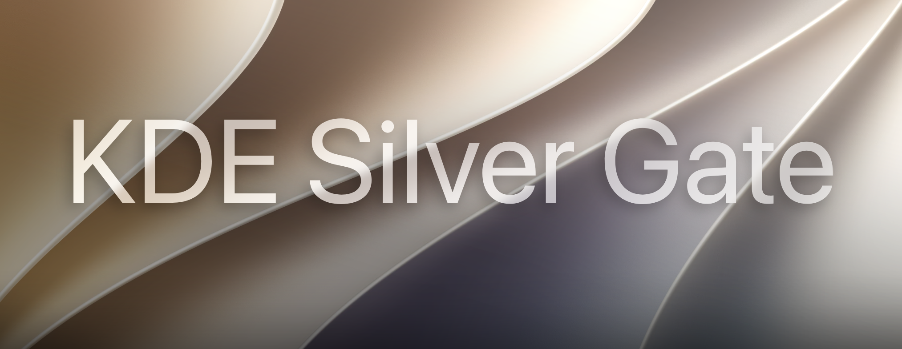
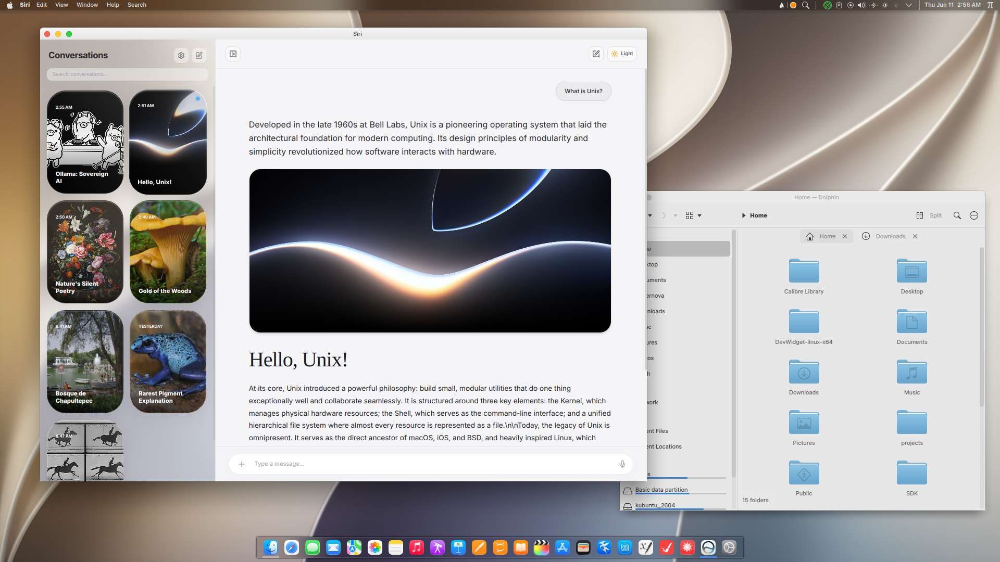
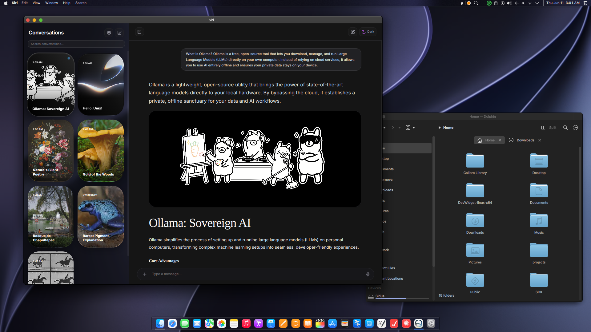
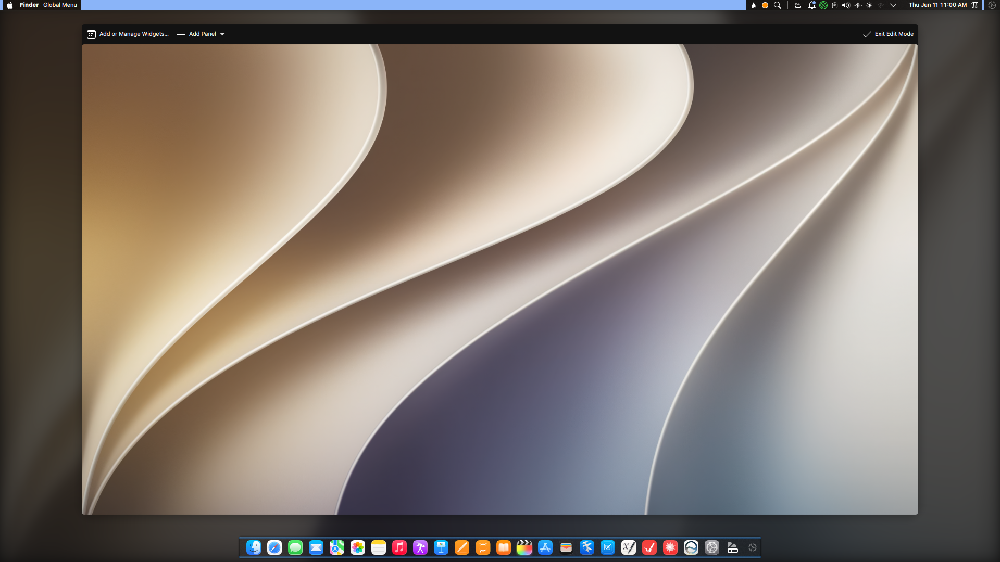
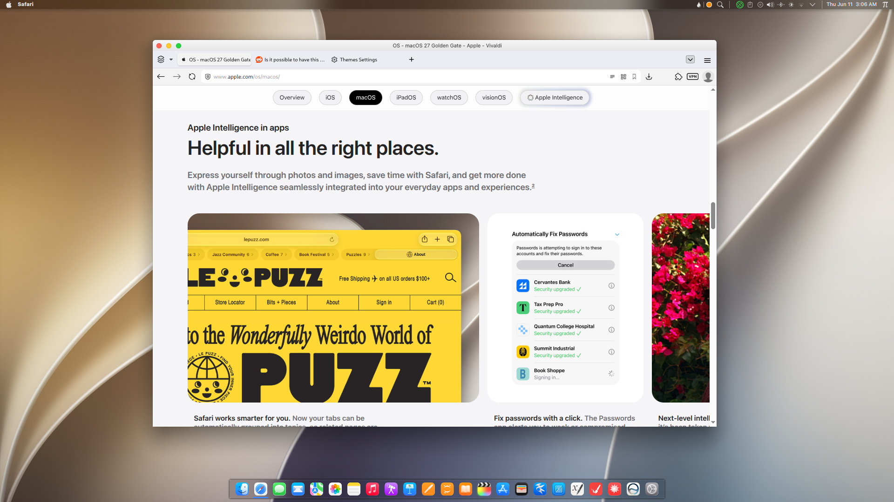
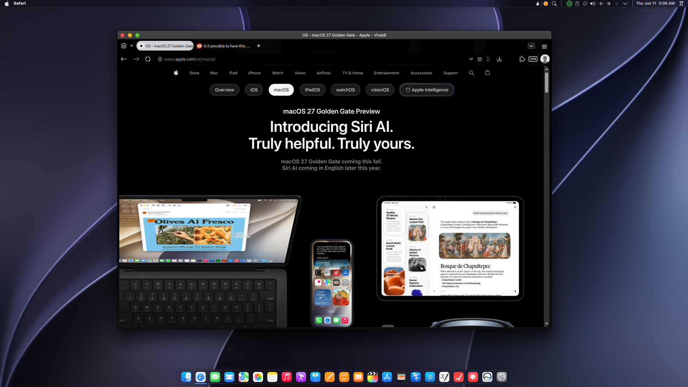

# KDE Silver Gate


## Screenshots
---




---

This guide explains how to install and configure the **KDE Silver Gate** theme for KDE Plasma.

Silver Gate combines a custom Plasma theme, color schemes, and a Kvantum theme to recreate a macOS-inspired desktop experience with transparency and blur effects.

> **Prerequisite:** Install the Kvantum theme engine before proceeding. Kvantum is required for the window blur and transparency effects used by Silver Gate.

Download the latest **SilverGatePackage_vX.X.tar.gz** release and extract it to a convenient location before starting.

---

# 1. Install the Color Schemes

The color scheme defines window, text, and interface colors.

1. Open **Dolphin**.
2. Navigate to your home directory.
3. Press **Ctrl + H** to display hidden files.
4. Open:
   ```
   ~/.local/share/color-schemes/
   ```
   Create the folder if it does not already exist.
5. Copy the following files into the directory:
   ```
   SilverGate27.colors
   SilverGate27Dark.colors
   ```

---

# 2. Install the Plasma Theme

The Plasma theme controls the appearance of panels, widgets, menus, and desktop elements.

1. Navigate to:
   ```
   ~/.local/share/plasma/desktoptheme/
   ```
   Create the directory if necessary.
2. Copy the entire folder:
   ```
   SilverGate27
   ```
   into the `desktoptheme` directory.

---

# 3. Install the Kvantum Theme

The Kvantum theme provides the macOS-style window appearance, including transparency and blur effects.

### Recommended Method

1. Open **Kvantum Manager**.

2. Select the **Install/Update Theme** tab.

3. Click **Select a Kvantum Theme Folder**.

4. Choose the:

   ```
   KSilverGate
   ```

   folder from the extracted package.

5. Click **Install This Theme**.

### Manual Installation

Alternatively, copy the folder directly to:

```
~/.config/Kvantum/
```

---

# 4. Install Recommended Assets

To complete the Silver Gate experience, install the following recommended assets and customization tools.

### Icons

**MacTahoe Icons**
https://github.com/vinceliuice/MacTahoe-icon-theme

Alternative icon themes:

* WhiteSur Icons
* Sumac Molten Glass

Both are available through the KDE Store.

---

### Window Decorations

**McMojave Aurorae**
https://store.kde.org/p/1305005

Provides macOS-style window controls ("traffic light" buttons). For the most authentic appearance, consider positioning the window controls on the top-left side of the title bar.

---

### Cursor Theme

**Qogir Cursors**
https://github.com/vinceliuice/MacTahoe-icon-theme/tree/main/cursors

A collection of macOS-inspired cursor themes that pair well with Silver Gate.

---

### Wallpaper

**Official macOS 27 Golden Gate Wallpapers** *(Optional)*
https://9to5mac.com/2026/06/08/download-the-official-macos-27-golden-gate-wallpapers-here/

Using Apple's Golden Gate wallpapers will help recreate the appearance shown in the screenshots, though any wallpaper can be used.

---

### Panel Customization

**Panel Colorizer** *(Highly Recommended)*
https://store.kde.org/p/2130967

Provides additional customization options for Plasma panels, allowing you to fine-tune the appearance of the menu bar and dock.

---

### Fonts

**San Francisco Pro Fonts**
https://github.com/sahibjotsaggu/San-Francisco-Pro-Fonts

Install the fonts normally and rebuild your font cache afterward. For the closest macOS appearance, **SF Pro Text Regular at 8 pt** is recommended.

---

# 5. Apply the Theme

Open **System Settings** and configure the following:

### Colors

**Appearance → Colors**

Select:

```
SilverGate27
```

or

```
SilverGate27Dark
```

### Plasma Style

**Appearance → Plasma Style**

Select:

```
SilverGate27
```

### Application Style

**Appearance → Application Style**

Select:

```
Kvantum
```

### Kvantum Theme

1. Open **Kvantum Manager**.

2. Navigate to **Change/Delete Theme**.

3. Select:

   ```
   KSilverGate
   ```

   or

   ```
   KSilverGateDark
   ```

4. Click **Use This Theme**.

---

# 6. Configure the Desktop Layout

The recommended layout consists of a macOS-style menu bar at the top and a floating dock at the bottom.



## Top Menu Bar

1. Right-click the desktop and select **Enter Edit Mode**.

2. Remove any panels you do not intend to use.

3. Select:

   ```
   Add Panel → Empty Panel
   ```

4. Position the panel at the **top** of the screen.

5. Configure the panel to:

   * Remain visible at all times.
   * Use a translucent background.
   * Enable floating applets only.

### Recommended Widget Layout

From left to right:

* Application Dashboard
* Global Menu
* Panel Spacer
* System Tray
* Search
* Digital Clock
* Use Panel Customizer to add borders or change transparency

Optional spacers may be added at both ends of the panel to improve spacing.

### Panel Size

A height of approximately **20 px** provides a clean, macOS-like appearance.

---

## Bottom Dock

1. While still in Edit Mode, create a second panel:

   ```
   Add Panel → Empty Panel
   ```

2. Position the panel at the **bottom** of the screen.

3. Configure the panel:

### Appearance

* Floating: Panel and applets
* Background: Translucent
* Avoid Windows
* Use Panel Customizer to add borders or change transparency

### Layout

* Length: **Fit Content**
* Alignment: **Center**

4. Add the following widget:

   * Icons-only Task Manager

5. Exit Edit Mode.

### Pinning Applications

To add applications to the dock:

1. Launch the application.
2. Right-click its icon in the dock.
3. Select **Pin to Task Manager**.

---

# Final Notes




Some transparency, blur, and panel effects may not fully initialize until you log out and back in. If visual elements appear incorrect after installation, restart your Plasma session before troubleshooting.

Silver Gate is provided **as-is**, without warranty or guarantee of compatibility across all KDE Plasma versions, distributions, hardware configurations, or third-party customization setups. While every effort has been made to ensure a consistent experience, individual results may vary depending on your system configuration.

I'm unfortunately very busy and can't dedicate enough time to create or maintain an automated installation script for Silver Gate. The theme is therefore distributed as a manual installation package, and users are expected to follow the setup instructions provided in this guide. Sorry, everyone! :(

Community contributions are always welcome. If anyone would like to develop and maintain an installation script or package for Silver Gate, feel free to do so and share it with the community.

Enjoy your new Silver Gate desktop experience!

---

# Credits:
- vinceliuice: Truly an incredible artist who's done a lot to make this theme possible - https://github.com/vinceliuice/
- zayronXIO: Another incredible artist, go check out his other stuff - https://store.kde.org/u/zayronXIO
- If anyone is missing here, please let me know and I'll add them in a hearbeat!

---

*AI Disclaimer: Artificial Intelligence was used in order to translate this guide and make it clearer. English isn't my first language, so please excuse me!*
